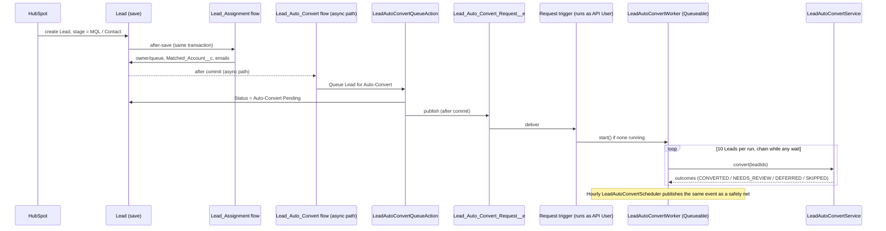

# Developer Reference – Champions Oncology MQL Lead Auto-Convert

**Status (Nov 17, 2026):** built and fully tested in the **champsDev** sandbox. **Not deployed to production.**
**Repo:** this repository (`main`). **Client:** Champions Oncology. **Partner:** Coastal Cloud.

Full technical detail. For the short version, start with [DEVELOPER_HANDOFF.md](DEVELOPER_HANDOFF.md). Other docs:
[DESIGN.md](DESIGN.md) (rules), [TESTING_GUIDE.md](TESTING_GUIDE.md) (how to test), [TESTING.md](TESTING.md) (results),
[DEPLOYMENT.md](DEPLOYMENT.md) (go-live), [REVIEW.md](REVIEW.md) (gaps).

---

## 1. The client request

Champions wants new **nurture-route MQL Leads** from HubSpot converted automatically into a **Contact** and an
**Opportunity** on the correct existing **Account**, so reps don't convert them by hand. Anything that can't be
converted safely goes to the Lead owner for **manual review**.

Agreed on the Oct 30, 2026 call (Coastal: Leigh Anna Ruggieri, Earl Major, Spencer Horowitz, Kendall Demavivas;
Champions: Zachary Rosfjord, Colleen Jennings, Gavin Cooper):

- Use **Apex** for conversion and Opportunity creation (Flow can't auto-convert Leads).
- All Leads originate in **HubSpot** and sync to Salesforce as Leads (not Contacts).
- Keep the existing **Lead Assignment** flow and its emails; conversion happens after it.
- BD list uploads are out of scope (they arrive already owned and must not auto-convert).
- Zip-code routing for CA/UK was dropped.

Rules confirmed afterwards with the Coastal project lead (Nov 11–14) are in section 3.

---

## 2. Orgs and access

| Item | Value |
|---|---|
| Sandbox | `champsDev` (CLI alias), full-copy sandbox `cofull`, org `00Dcb00000G851JEAR`, API 68.0 |
| Sandbox URL | `https://championsoncology--cofull.sandbox.my.salesforce.com` |
| CLI user | "Coastal Cloud" (`champions-oncology@coastalcloud.us.cofull`) – **blocked from creating Opportunities** by a validation rule (see §9) |
| Run-as user | **API User** (`mweinstein@championsoncology.com[.cofull]`, System Administrator) |
| Production | Not deployed. Production-only config is in `deploy/production/`. |

---

## 3. Business rules (confirmed)

| Area | Rule |
|---|---|
| Trigger | TOS Lead that has `HubSpot_Lifecycle_Stage__c = "MQL / Contact"` **when it is created, or gets it within 1 minute of being created** (HubSpot sometimes sends the stage in a follow-up sync, seen in the sandbox on Nov 17, 2026). A Lead is queued once; Leads that become MQL later than 1 minute are ignored (they appear in the *MQL Leads Not Picked Up* report). |
| Order | Existing `Lead_Assignment` flow runs first, **unchanged** (owner/queue, `Matched_Account__c`, emails). Do **not** add a "skip MQL" condition to it. |
| Account | TOS record type only. First that finds exactly one Account wins: **exact name → alias → cleaned name → Lead Assignment's match → review**. Main/global Account preferred over site Accounts. Never creates Accounts. |
| Owner | Lead owner. Queue-owned Lead (CA/MA/UK queues) → the chosen Account's owner. Fallback user alias `cjenn` (Colleen Jennings). |
| Contact | Record type General. Existing Contact with the same email on the chosen Account is reused; on another Account → review. |
| Opportunity | TOS record type, stage **Proposed** (default probability 50%), Amount **$1**, close date **end of this month if created day 1–21, else end of next month**, `Principal_Investigator__c` = converted Contact, Lead Source and Referred By copied. Name/number set by the existing naming flow. |
| Review | Status **Needs Manual Review** + Task on the Lead for the owner + email (from `no-reply@championsoncology.com`, optional CC). |
| Run as | **API User**. |
| Scope | TOS only (not POS, not TOS Tier A Accounts). |

### The process, step by step (business view)

1. **HubSpot** scores a nurture contact as an MQL and syncs it to Salesforce as a **Lead** with HubSpot Lifecycle
   Stage `MQL / Contact`. BD list uploads keep their existing path and are not converted.
2. **Lead Assignment** (existing) assigns the owner or a regional queue, finds a Matched Account by email
   domain, and sends its usual notification emails.
3. A moment later, **auto-convert** picks the Lead up and decides which TOS Account it belongs to: exact
   company name, then an admin alias, then the name ignoring "Inc"/"LLC"/punctuation, then Lead Assignment's match.
4. **If an Account is found**, the Lead becomes a **Contact** on that Account (or joins an existing Contact
   with the same email), and a new **Opportunity** is created: Proposed, $1, closing at month end, with the
   Contact as Principal Investigator. The rep owns both; for queue Leads, the Account owner does.
5. **If not**, the Lead is marked **Needs Manual Review** and the owner gets a **Task and an email** saying why.
   The rep converts it by hand, or fixes the Company and sets the Status back to **Auto-Convert Pending**.
6. Admins watch two reports (*Leads Waiting for Auto-Convert*, *MQL Leads Needing Manual Review*) and can switch
   the whole thing off with one checkbox.

---

## 4. Architecture



### Components (`force-app/main/default`)

| Component | Type | Responsibility |
|---|---|---|
| `Lead_Auto_Convert` | Record-triggered flow, Lead, after save, **Create and Update**, "only when a record is updated to meet the conditions", async path | Entry filter: stage = `MQL / Contact`, not converted, TOS record type, and `(NOW() - CreatedDate) * 1440 <= 1` (minutes). Calls the queue action. Ships **Draft** in the repo. |
| `LeadAutoConvertQueueAction` | Invocable Apex | Sets Status to pending (bulk), publishes one start request. No-op when inactive. |
| `Lead_Auto_Convert_Request__e` | Platform event (HighVolume, PublishAfterCommit), field `Source__c` | The start signal. Exists so the job runs as a fixed user. |
| `LeadAutoConvertRequestTrigger` | Trigger on the event | No logic; calls the handler. |
| `LeadAutoConvertRequestHandler` | Apex | Calls `LeadAutoConvertWorker.start()` once per batch. |
| `LeadAutoConvertWorker` | Queueable + `RunFailureHandler` (Transaction Finalizer) | Takes `Leads_Per_Run__c` oldest pending Leads, converts, chains while progress is made. Finalizer retries failed runs at half size, then sends the single failing Lead to review. |
| `LeadAutoConvertService` | Apex (without sharing) | Conversion steps (§5). |
| `LeadAutoConvertAccountMatcher` | Apex | Account choice (§5.2). |
| `LeadAutoConvertSelector` | Apex | All SOQL (pending Leads, `FOR UPDATE` load, Accounts by name and by prefix, Contacts by email, users, org-wide address, open jobs). |
| `LeadAutoConvertNotifier` | Apex | Review Task + email (custom labels for wording). |
| `LeadAutoConvertScheduler` | Schedulable | Hourly safety net: publishes a start request if active. |
| `LeadAutoConvertSettings` | Apex | Reads the `Default` settings record. |
| `Lead_Auto_Convert_Setting__mdt` | Custom metadata + layout | Admin settings (§6). |
| `Lead_Auto_Convert_Account_Alias__mdt` | Custom metadata + layout | Alias list (Alias, Account Name, Active). Ships empty. |
| `LeadStatus` value set, Lead `TOS` business process | Metadata | Adds **Auto-Convert Pending** and **Needs Manual Review**. |
| `HubSpot_Lifecycle_Stage__c` | Lead field (Text 255) | The flag field (created in the sandbox by Coastal on Oct 15; included so prod deploys don't depend on it). |
| `CustomLabels` | Labels | `Lead_Auto_Convert_Review_Subject`, `Lead_Auto_Convert_Review_Body` (MessageFormat; no apostrophes). |
| `reports/Lead_Auto_Convert` | Report folder + 4 reports | *Leads Waiting for Auto-Convert* (should be empty), *MQL Leads Needing Manual Review*, *MQL Leads Not Picked Up* (MQL Leads the automation never touched), *MQL Lead Outcomes* (every TOS MQL Lead grouped by Status, converted Leads included). |
| `deploy/production/` | PlatformEventSubscriberConfig | Runs the trigger as API User in production (username differs per org). |

---

## 5. Processing logic in detail

### 5.1 Service steps (`LeadAutoConvertService.convert`)

1. **loadItems** – locks Leads with `FOR UPDATE`; SKIPPED if converted or no longer pending (so overlapping runs can't double-process).
2. **resolveAccounts** – matcher picks the Account (5.2).
3. **resolveOwners** – user-owned → Lead owner; queue-owned → chosen Account owner if active; else fallback alias; none → review.
4. **requireAccounts** – no Account → review with the matcher's reason.
5. **checkExistingContacts** – same email on chosen Account → reuse; on another Account → review.
6. **deferSharedAccounts** – one Lead per Account per run (DEFERRED). The naming flow numbers from a roll-up that only moves between saves, so this keeps project numbers unique.
7. **createOpportunities** – inserted **before** conversion (the naming flow fires on create only), `allOrNone=false`.
8. **convertLeads** – `Database.convertLead` with `setOpportunityId`, `setOwnerId`, `setSendNotificationEmail(false)`, optional `setContactId`.
9. **removeUnusedOpportunities** – deletes Opportunities whose Lead didn't convert.
10. **applyContactRecordType** – sets General (conversion uses the owner's default, often Patient).
11. **linkPrincipalInvestigator** – sets `Principal_Investigator__c`; org automation then adds a "Principal Investigator" contact role.
12. **flagForReview** – sets review Status, then Task + email. If the status update fails, the Lead is DEFERRED (stays pending).

Every DML is per-record tolerant (`allOrNone=false`), so one bad Lead doesn't fail the batch.

### 5.2 Account matching (`LeadAutoConvertAccountMatcher`)

Only record types in `Account_Record_Types__c` (default `TOS`). Each step must find **exactly one** Account;
a step that finds several is ambiguous and skips the remaining name steps.

1. **Exact** – `Name IN :companies` (SOQL is case-insensitive).
2. **Alias** – `cleanKey(Company)` looked up in active alias records → exact Account Name.
3. **Cleaned** – candidates `Name LIKE :prefixes` (`firstWord%`, `the firstWord%`, capped at 2,000 rows), compared by `cleanKey`: lowercase, `&`→`and`, non-alphanumerics removed, leading "the" dropped, trailing suffixes dropped (inc, incorporated, llc, llp, lp, ltd, limited, corp, corporation, co, company, plc, gmbh, ag, sa, nv, bv, srl, pty, and). No stored field, so no Account data changes.
4. **Flow** – `Matched_Account__c` if it exists and is TOS.
5. Otherwise the reason is returned and the Lead goes to review.

Two queries per run. Sandbox: exact 29.1% + cleaned 15.5% = **44.5%** of TOS Leads; the flow alone ~7%.

### 5.3 Failure handling

- Unhandled exception → whole run rolls back → finalizer re-queues at half size (10→5→2→1) → a single failing Lead goes to review ("Automatic conversion failed: …").
- **Platform limit:** a finalizer may re-queue only **5 consecutive** failed jobs. Under a systemic failure the chain stops and the hourly check takes over (about one Lead per hour to review). Monitoring report covers this.
- Chaining only continues after progress, so a Lead that can never leave pending can't loop.

### 5.4 Opportunity naming

The build does **not** name Opportunities. It inserts a placeholder (`Company – MQL`, required to save), and the
existing before-save flow `Opportunity_Before_Save_Naming_and_Numbering` (create only) replaces it:

| Field | Formula | Example |
|---|---|---|
| Project Sequence | Account `Highest_Opp_Sequence__c` + 1, or the Account's `Project_Number__c` (or 1) if it has none | 102 |
| Project | `Account_Number__c` + "-" + sequence padded to 3 | `99959-102` |
| Name | Project + " " + Account Name | `99959-102 ACT Shared 82195` |

The Opportunity is created **before** conversion so this flow numbers it, and only one Lead per Account is
converted per run because the roll-up only updates between saves. Accounts with no `Account_Number__c` (59% of
TOS Accounts) get names like `-100 Company` – existing behaviour, client decision. Auto-created Opportunities can
be identified by Created By = API User; an "Auto-Created from MQL" checkbox is an optional addition.

### 5.5 Close date

`LeadAutoConvertSettings.closeDateFor(today)`: day ≤ `Close_Date_Cutoff_Day__c` (21) → last day of this month; else last day of next month.

---

## 6. Settings (`Lead_Auto_Convert_Setting__mdt`, record `Default`)

| Field | Repo value | Meaning |
|---|---|---|
| Active__c | **false** (sandbox: true) | Master switch. Leads created while off are not picked up later. |
| Leads_Per_Run__c | 10 | Batch size (larger runs hit SOQL 1101 in testing). |
| Pending_Status__c / Review_Status__c / Converted_Status__c | Auto-Convert Pending / Needs Manual Review / Qualified | Lead statuses. |
| Contact_Record_Type__c | General | |
| Opportunity_Record_Type__c / Opportunity_Stage__c | TOS / Proposed | |
| Opportunity_Amount__c | 1 | |
| Close_Date_Cutoff_Day__c | 21 | |
| Account_Record_Types__c | TOS | Comma list of Account record type API names. |
| Fallback_Owner_Alias__c | cjenn | |
| Org_Wide_Email_Address__c | no-reply@championsoncology.com | Sender for review emails. |
| Review_Email_Cc__c | blank (sandbox: project lead's address) | Copies of every review email; count toward the daily email limit. |

Changing a value in a sandbox from the CLI: retrieve the live record, edit only that value, deploy it back
(deploying the repo copy would reset Active and the CC).

---

## 7. Running user

The worker runs as whoever enqueues it, so the event trigger's running user decides everything.

| Option | Result |
|---|---|
| Lead creator | Inconsistent; Coastal Cloud user blocked from creating Opportunities. Rejected. |
| Automated Process (default for event triggers) | "Record Type ID isn't valid for the user" on the TOS Opportunity record type. Rejected. |
| Hubspot Integration | Can't see `Matched_Account__c` (query fails). Rejected. |
| **API User** | Works. Chosen. Long-term recommendation: a dedicated integration user + permission set (free Salesforce Integration licenses exist). |

Changing the running user: deploy the `PlatformEventSubscriberConfig`, then Setup → Platform Events →
Lead Auto Convert Request → Subscriptions → Manage → **Suspend**, then **Resume**. Redeploying the trigger does
not apply it.

---

## 8. Existing org automation this depends on or touches

| Item | Relevance |
|---|---|
| `Lead_Assignment` flow (v11, active since Jul 13, 2026) | Sets owner/queue and `Matched_Account__c` by email domain (+ city/state/country, Key Account). **Every path sends emails, including hard-coded real addresses (tcates@, cjennings@)** – creating test Leads in the sandbox emails real people. |
| `Opportunity_Before_Save_Naming_and_Numbering` flow | Names/numbers new Opportunities from `Account_Number__c` and the `Highest_Opp_Sequence__c` roll-up. 59% of TOS Accounts have no Account Number → names like "-100 Company". |
| `UpdateAmount` trigger | Fails when Amount is blank (hence Amount is always set). |
| Principal Investigator automation | Adds a "Principal Investigator" Opportunity contact role when the field is set. |
| Other Opportunity triggers | CPQ (SBQQ), Showpad, DLRS rollups – no issues seen. |
| Validation rules | `Deny_Coastal_Cloud_ac_from_creating_opp` (blocks the Coastal Cloud user); `Referred_By` (referral Lead Source needs Referred By – the Lead has the same rule, so it can't reach us); `Mandatory_rule` (Closed/Won only). |
| Duplicate rules | Account `Account_Name` (**Block**); Contact `Custom_Contact_Matching_Rule` (**Block**, exact email vs Contacts and Leads); Lead `Custom_Lead_Duplicate_Rule` (**Block**, exact email). |
| Lead assignment rules | Run on REST API updates by default (e.g. `sf data update record`) and can reassign test Leads. Apex updates don't. |

---

## 9. Gotchas learned the hard way

- **Scheduled job blocks deploys** of the classes it references. Run `scripts/apex/lead-auto-convert-pause-hourly.apex`, deploy, then `...-schedule-hourly.apex`.
- **Tests see real scheduled jobs.** The scheduler test schedules under its own name for this reason.
- **Production deploys as the Coastal Cloud user fail RunLocalTests** (org tests hit the Coastal Cloud validation rule). Use RunSpecifiedTests with the three test classes, or another admin.
- **`LeadStatus` value set and the TOS business process deploy as full lists.** Merge production's current values before deploying.
- **Custom metadata layouts:** Salesforce-generated layouts omit custom fields; both layouts are in the repo. Layouts need `IsProtected` and `NamespacePrefix`.
- **Retrieving a single Lead field pulls `Lead.object-meta.xml`.** Delete it; deploying it could overwrite Lead settings.
- **Sandbox user emails end in `.invalid`.** Prove email delivery with the Review Email CC setting.
- **A flow's async path doesn't run in Apex tests**, so the flow's entry rule (incl. the 1-minute window) is
  tested live in the sandbox, not by Apex tests.
- **Custom metadata can't be inserted in tests** – the matcher exposes `aliasOverride`; Settings expose `testRecord`.
- **Duplicate rules block same-name Accounts in tests** – ambiguity is tested with in-memory records via `matchAll`.
- **Validation/duplicate error messages come back HTML-encoded** – unescaped before going into Tasks/emails.

---

## 10. Tests

| Class | Covers |
|---|---|
| `LeadAutoConvertServiceTest` | Conversion rules end to end: matching paths, owners, Contact reuse/conflict, Opportunity values, close-date rule, review Task/email + CC, rollback, skip/defer, 200-Lead bulk review. |
| `LeadAutoConvertWorkerTest` | Single worker, chaining, finalizer retry/review, off switch, queue action (200), event handler and delivery, hourly scheduler. |
| `LeadAutoConvertAccountMatcherTest` | `cleanKey`, exact/alias/cleaned/flow order, ambiguity, non-TOS, deleted match, 200-Lead bulk in 2 queries. |
| `LeadAutoConvertTestData` | Shared fixtures (runner + account-owner users, settings, Leads written back after Lead Assignment). |

39 tests pass, including with the real hourly job scheduled. Run:

```
sf apex run test -o champsDev -n LeadAutoConvertServiceTest -n LeadAutoConvertWorkerTest -n LeadAutoConvertAccountMatcherTest -w 20
```

**How to test:** step-by-step in [TESTING_GUIDE.md](TESTING_GUIDE.md).

**Live scenarios:** `scripts/apex/lead-auto-convert-scenarios.apex` creates tagged `ACT ...` Accounts, Contacts and
Leads covering S1–S12 and S20–S22. Set sandbox Deliverability to **System email only** first (Lead Assignment
emails real people). Latest full run (tag `82195`): 17/17 checks passed. Edge checks S14–S19 (off switch, close
date, failure recovery, hourly safety net, manual re-queue) and S13 (review email via CC) passed. Details in
[TESTING.md](TESTING.md).

---

## 11. Deployment summary

Full steps in [DEPLOYMENT.md](DEPLOYMENT.md). In short: merge production `LeadStatus`/TOS process → validate
with RunSpecifiedTests → deploy (ships Active = false, flow Draft) → deploy `deploy/production/` + Suspend/Resume
→ activate flow → schedule hourly check as an admin → subscribe an admin to the waiting-Leads report → tick Active.

Rollback: untick Active (no deploy). Conversions themselves can't be undone.

---

## 12. Open items

| Item | Owner |
|---|---|
| Confirm HubSpot maps and sends `MQL / Contact` **on Lead create** in production (nothing in Salesforce sets it; sandbox has no example) | Zach, Kendall |
| Confirm BD uploads never arrive as `MQL / Contact` | Zach, Kendall |
| Don't add the planned skip condition to Lead Assignment | Spencer |
| Optional 500-Lead volume test; live re-run of failure recovery on final code | Coastal dev |
| Account Number gap (naming flow) – client decision | Champions |
| Dedicated integration user instead of API User | Champions / Coastal |
| Seed aliases (BMS, GSK, Lilly, DCB, IRB Barcelona) | Champions admin |
| Clean up sandbox test data (`ACT ...` tags 89466, 82195; alias "ACT Alias 89466") | Coastal dev |
| Phase 2 option: fuzzy "Suggested Account" on review Tasks (suggest only, never auto-convert) | — |

---

## 13. Decision log

| Decision | Alternatives rejected | Why |
|---|---|---|
| `MQL / Contact` on create, or within 1 minute of creation | Create only; any later update to MQL; 1-hour, 10-minute or 5-minute window; a scheduled "wait then check" path | Client: only new MQLs. HubSpot sent the stage 20 s after creating one Lead (Nov 17), so create-only missed it. Client chose a short window: 1 minute covers the observed 20 s delay; slower syncs show in the *MQL Leads Not Picked Up* report. |
| Name match before flow match | Flow first | Client prefers main Accounts; flow data had issues (deleted Accounts, wrong domains); reps chose the name match more often. |
| Cleaned matching in Apex, no stored field | `Match_Name__c` on Account + backfill | Avoids updating ~10k Accounts and firing all Account automation. |
| Alias list in custom metadata | Hard-coded aliases | Client-maintained, no deploys. |
| No fuzzy auto-conversion | Fuzzy matching | Conversion can't be undone; fuzzy only as a future suggestion. |
| Platform event + API User | Run as creator / Automated Process / Hubspot Integration | See §7. |
| Review instead of creating Accounts | Placeholder Accounts | Client: never create duplicate Accounts. |
| Patient-Account rule removed; TOS-only Accounts | Separate Patient check | Client: only TOS record type counts. |
| Stage Proposed with default 50% probability | 5% probability | Client choice. |
| Queue Leads → Account owner | Fallback user for all queue Leads | Client choice. |
